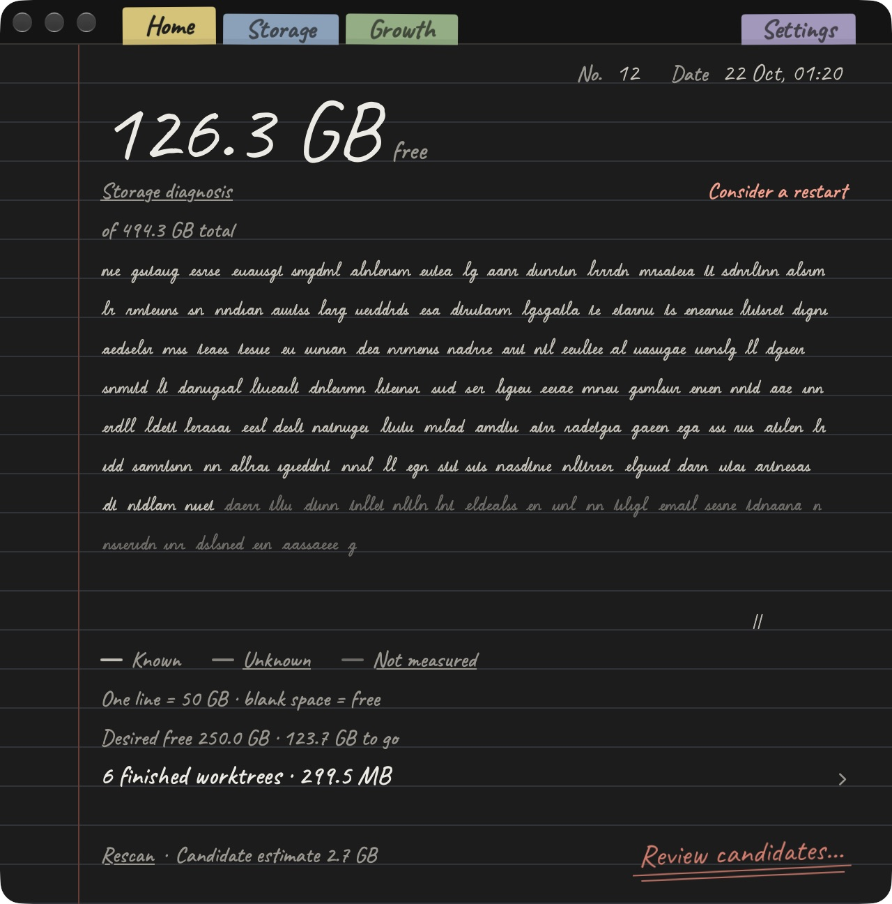

# Yeoback · 여백

### Make room for your next project.

A native Mac app for seeing where your storage goes and deciding what deserves to stay.

*Actual installed interface · version 0.4.19 (31) · captured 22 October 2026. Storage figures reflect one local scan; they are not a promised saving. In development; a public download is not available yet.*

**See the space. Understand the candidates. Make the decision.**

## A notebook for the space around your work

Projects accumulate: experiments, build copies, finished worktrees and files you may still need. Yeoback begins with a readable view of the disk, then gives you a place to investigate before acting.

The current Home screen brings together free space, the scan date, a storage diagnosis and a route to review candidates. It distinguishes **known**, **unknown** and **not measured** storage, so an incomplete scan does not look like a complete answer.

The notebook pages and coloured tabs give that practical work a familiar place to live: Home, Storage, Growth and Settings.

## Why “Yeoback”?

**여백** is the space around what matters. I am building Yeoback around that idea: make room for the next piece of work while keeping enough context to protect what matters now.

A possible saving and recovered space are different things. Moving something to Trash does not immediately free its space; the product's language and review workflow need to respect that distinction.

## From the question to the finished detail

Yeoback is my independent native Mac product. My work spans the product direction, notebook interface, implementation and checks around file-review decisions. I use ChatGPT for research, planning and building, and Claude for design refinement and finishing, with my own review throughout.

This public repository presents the product. The implementation and personal file records remain private while development continues.

---

[Explore my other projects](https://github.com/EricEremos) · [Professional profile](https://www.linkedin.com/in/ericmos/)
