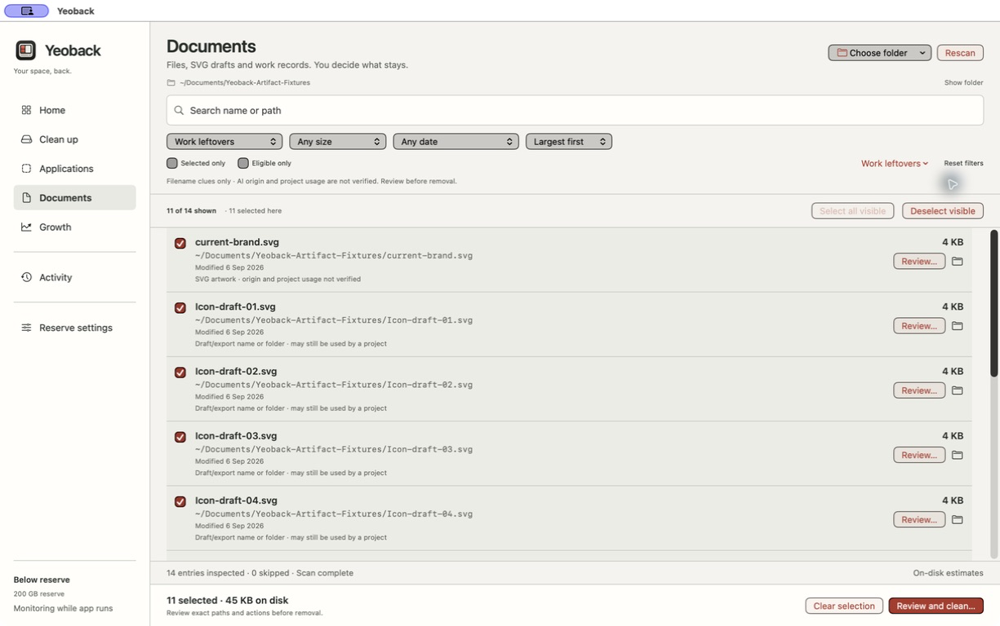
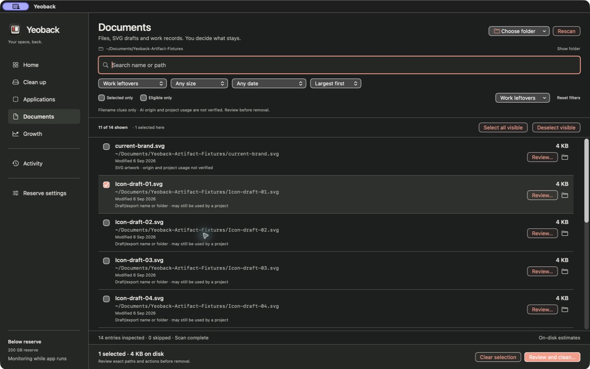

# Yeoback · 여백

### Make room with a clearer view of what is there.

A Mac workspace for understanding your files before you decide what to remove.

[See the workbench](#a-clearer-view-before-a-big-decision) · [Meet the maker](https://github.com/EricEremos)

*Actual native Mac interface, captured with sample files. Yeoback is in development; a public download is not available yet.*

## A clearer view before a big decision

Storage cleanup starts with a question: **what is this, and do I still need it?** Yeoback brings the file, its location and the review controls into one workspace, so that question has something concrete behind it.

| Understand what is there | Review what you chose | Decide with context |
| --- | --- | --- |
| Search and filter a scoped view of your files. | Inspect the exact paths in your selection, including selected items hidden by a filter. | Review the proposed action before proceeding, then check the resulting state. |

## Why “Yeoback”?

**여백** is the space around what matters. That idea shapes both the interface and the product: enough room to read, enough context to decide, and a clear distinction between a possible saving and space that has actually been recovered.

Moving a file to Trash does not immediately free its space. Yeoback's review process treats that distinction as part of the decision, rather than promising a bigger number than the result can support.

## What I am building

I am developing Yeoback as a native Mac product, bringing together the file-review workflow, interface and checks around consequential actions. The light and dark workbenches above show the implemented application with sample data; they are not generated UI illustrations.

This public repository is the product showcase. The implementation remains private while development and distribution work continue.

---

[Explore my other projects](https://github.com/EricEremos) · [Professional profile](https://www.linkedin.com/in/ericmos/)
