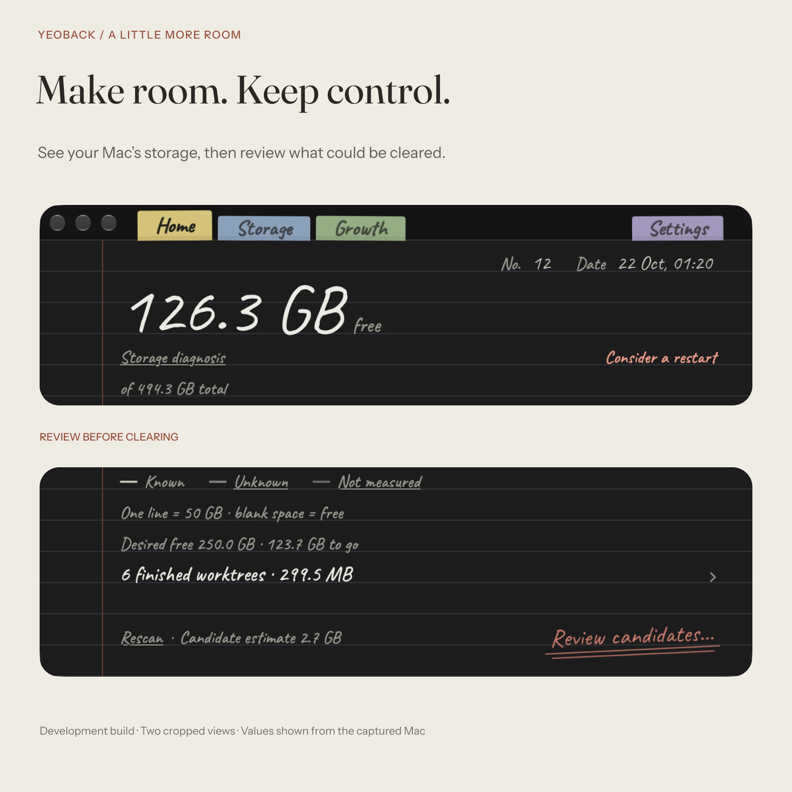

<strong>Yeoback · 여백</strong>

<h1 align="center">Make room. Keep control.</h1>

A native Mac app for understanding your storage before deciding what to clear.

<a href="#see-the-space-understand-the-candidates">Explore the experience</a> · <a href="#development-status">Development status</a>

## Watch the product film

[Watch the full MP4](assets/yeoback-promo-20261024.mp4) · [Open the still frame](assets/yeoback-promo-20261024-poster.png) · [Capture and production details](assets/yeoback-promo-20261024-manifest.json)

In development; no public download yet. Installed app v0.4.19 (31), captured on 22 October 2026. The 2.7 GB shown is an estimate of review candidates from one scan, not space already freed. Moving files to Trash does not immediately reclaim their storage.

## A notebook for the space around your work

Experiments, build copies, finished worktrees and files you may still need: a working Mac gathers more than finished projects. Yeoback gives you a readable view of that space and a place to investigate what belongs there.

## See the space. Understand the candidates.

**Start with the disk.** The Home screen brings together free space, the scan date and a storage diagnosis.

**Look closer.** Follow the route to review candidates with the scan's context still in view. Known, unknown and not measured remain distinct, so an incomplete scan does not appear to be a complete answer.

**Make the decision.** A potential saving is different from recovered space. Moving a file to Trash does not immediately free its storage; the review workflow and the wording need to respect that difference.

The notebook pages and coloured tabs give each part of the work its place: **Home, Storage, Growth and Settings**.

## Why “Yeoback”?

**여백** is the space around what matters. That idea guides the product: make room for the next piece of work while keeping enough context to protect what matters now.

The notebook is part of that approach. It gives storage review a familiar, readable setting for decisions that deserve more than a large number and a cleanup button.

## My work on Yeoback

Yeoback is my independent native Mac product. My work spans the product direction, notebook interface, implementation and checks around file-review decisions. The connection between those parts matters: a scan result has to become an explanation a person can act on.

## Development status

Yeoback is in development; a public download is not available yet. This repository presents the product while its implementation and personal file records remain private.

About the screen and storage figures

The campaign was composed in Figma around the installed interface, version **0.4.19 (31)**, captured on **22 October 2026**. Select the image to inspect the original Home screen.

Storage figures reflect one local scan. They are not a promised saving or evidence of space recovered on another Mac.

---

[Explore my other projects](https://github.com/EricEremos) · [Professional profile](https://www.linkedin.com/in/ericmos/)
